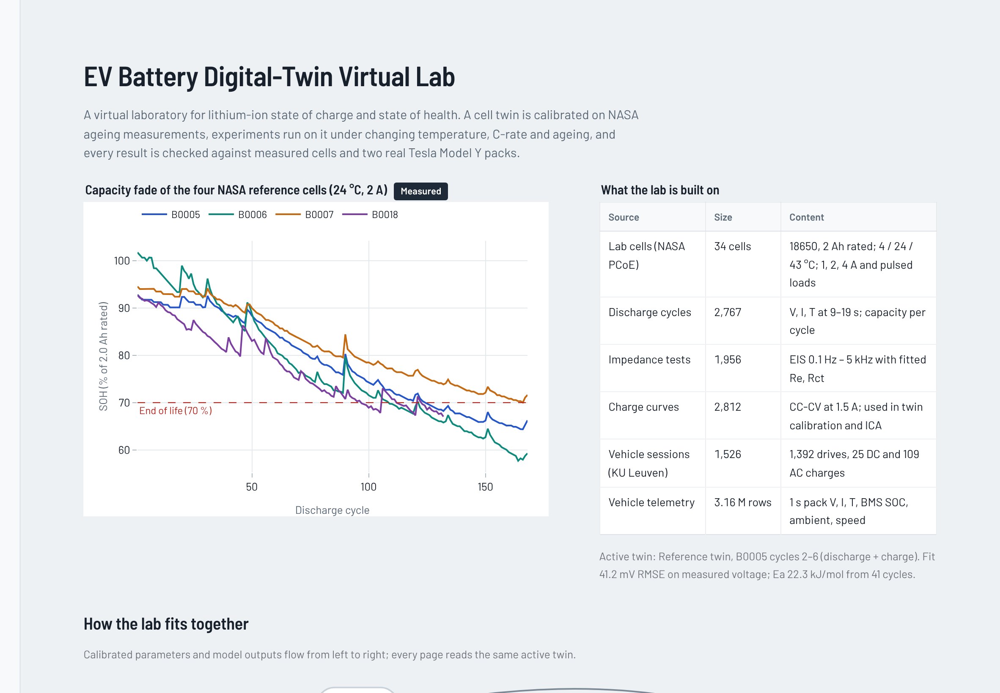
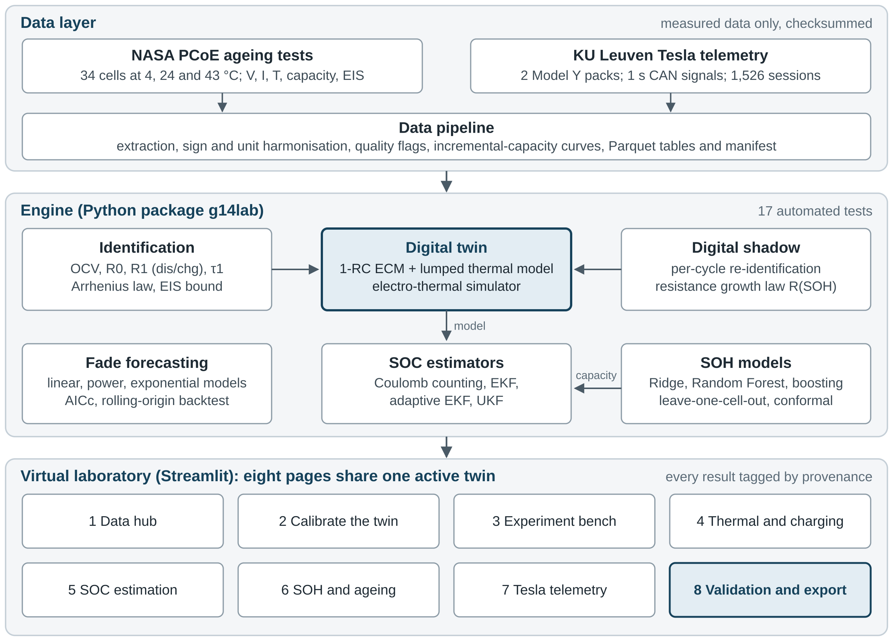

# EV Battery Digital-Twin Virtual Lab (SOC/SOH)

**Group 14, 21EEO601T Electric Vehicle Technology (LLT-1), SRM Institute of Science and Technology**
Bharathwaj Manoharan, Gokul Vasan R, Arvind Kumar

A virtual laboratory for lithium-ion **state of charge (SOC)** and **state of health (SOH)**. A cell digital twin is
*identified from measured data* (NASA PCoE ageing tests: 34 cells, 4 / 24 / 43 °C, 1 / 2 / 4 A and pulsed loads).
The lab runs electro-thermal experiments on it, compares SOC estimators under sensor faults, estimates SOH with
leakage-free machine learning, and checks everything against measured cells and two real Tesla Model Y packs
(KU Leuven, 1 s CAN telemetry).



## Start here: for the next group

Course-assigned title: **AI-Based Virtual Laboratory for Battery Digital Twin (SOC/SOH)**.

This repository is a working baseline that the next group can run, study and extend. Use it as a teaching lab
for SOC and SOH, as a test bench for new estimators and models, or as the starting point of an M.Tech project.
The original Group 14 report and presentation are in `docs/`.

1. **Run it (about 15 minutes).** Follow the [quick start](#quick-start): clone the `v1.2.0` source, download
   the matching data release, start the lab with `bash run.sh`, and click through the eight pages.
2. **Understand it (a few days).** Read the [technical report](docs/Group14_Technical_Report.pdf), then the
   engine in pipeline order: `data_pipeline.py`, `ecm.py` and `thermal.py`, `simulator.py`, `estimators.py`,
   `soh.py`, `calibration.py`. The pages in `pages/` only call the engine and plot the results.
3. **Extend it (your project).** Pick one of the [four M.Tech-level projects](#extend-it-four-mtech-level-projects)
   below. Add your method beside ours, run it on the same held-out cells, and show on the Validation page that
   it beats the [baseline results](#baseline-results-to-beat).

More detail:

- [Get the data and models](docs/DATA_SETUP.md)
- [Contribute changes](CONTRIBUTING.md)
- [Development roadmap](ROADMAP.md)
- [Third-party attribution](THIRD_PARTY_NOTICES.md)

## Quick start

Python 3.10 or newer is required. Start with the **v1.2.0** source and its matching
release data package. A Git clone or GitHub's automatic source ZIP alone does not
include the datasets or trained models.

On Linux, from a terminal:

```bash
git clone https://github.com/SreevanjiManoharan179/EVT_LLT_Project.git
cd "EVT_LLT_Project"
git switch --detach v1.2.0
curl -fL -O "https://github.com/SreevanjiManoharan179/EVT_LLT_Project/releases/download/v1.2.0/EVT_LLT_Project-v1.2.0-data.zip"
curl -fL -O "https://github.com/SreevanjiManoharan179/EVT_LLT_Project/releases/download/v1.2.0/SHA256SUMS"
sha256sum -c "SHA256SUMS"
unzip "EVT_LLT_Project-v1.2.0-data.zip" -d .
bash run.sh
```

Continue only if the checksum reports `OK`. macOS can use `shasum -a 256 -c SHA256SUMS`.
For Windows, or if `curl` or `unzip` is unavailable, download the source and data ZIPs
from the [v1.2.0 release](https://github.com/SreevanjiManoharan179/EVT_LLT_Project/releases/tag/v1.2.0),
then extract the data ZIP into the source folder beside `app.py`. On Windows, double-click
`run.bat`; on macOS, run `bash run.sh`. See [data setup](docs/DATA_SETUP.md) for the exact layout.

The launcher creates `.venv`, installs `requirements.txt`, prepares missing data/model
outputs, starts Streamlit on the first available port from 8501, and opens the browser.
The first launch needs internet for Python dependencies. With the release assets and
dependencies installed, the lab uses local data, models, and fonts. Press **Ctrl+C**
in the terminal to stop it.

Options include `--port 8600`, `--no-browser`, and `--rebuild`. Rebuilding uses the raw
archives and replaces the local processed data and model outputs. To install the Linux
desktop shortcut, use `bash run.sh --install-shortcut`.

If Ubuntu or Debian cannot create a virtual environment, install the distribution's
`python3-venv` package. For development, follow [CONTRIBUTING.md](CONTRIBUTING.md).

## The lab, page by page

| # | Page | What you can do |
|---|---|---|
| | Overview | Measured fade curves, data inventory, system diagram, demonstration path |
| 1 | Data hub & explorer | Browse every cell and Tesla session. View V/I/T traces, EIS Nyquist plots, histograms, scatter plots and Spearman correlations. See a data-quality profile and the data dictionary, and export to CSV |
| 2 | Calibrate the twin | Identify OCV(SOC), R0, R1, τ1, C_th, hA and the entropic coefficient dU/dT live from chosen discharges and the charges that follow them (EIS-bounded R0, temperature-aware fit). Compare measured vs simulated voltage and temperature on discharges and charges, see the Arrhenius map, and track how resistance ages in the digital shadow |
| 3 | Experiment bench | Run CC discharge, CC-CV charge, pulses or charge → rest → discharge, with initial SOC, C-rate, ambient and ageing set by a growth law or a measured cycle. Includes sweeps, A/B scenarios, a ±20 % tornado sensitivity, and validity warnings outside the calibrated domain |
| 4 | Thermal & fast charging | 36-run ΔT and usable-charge maps across C-rate × ambient, measured vs predicted temperature with the heat split, and Tesla DC power taper, C-rate and pack heating |
| 5 | SOC estimation | Coulomb counting vs EKF vs adaptive EKF vs UKF, with gain/offset/noise faults and a wrong initial SOC. Capacity comes from the RF SOH model, the twin or an oracle |
| 6 | SOH & ageing | Fade under each condition, incremental-capacity (dQ/dV) analysis, RF / Ridge / gradient boosting with leave-one-cell-out validation, conformal intervals and permutation importance, and a fade forecast with backtest |
| 7 | Tesla telemetry replay | Session replay with BMS power limits, BMS SOC vs Coulomb counting, energy use vs ambient over 721 drives, and pack chemistry inferred from data |
| 8 | Validation & export | Live re-validation of the active twin on 23 discharges and 10 CC-CV charges, SOC/SOH benchmarks, identified physical laws, limitations, and a ZIP export of logged experiments |

Every chart is tagged **Measured**, **Simulated**, **Estimated**, **Predicted** or **Reference**. The colours are used for provenance only.

## Baseline results to beat

Every number below is computed by this code (`python -m g14lab.calibration`). Compare new methods against
them under the same protocol: the same cells, the same held-out cycles and the same metrics.

| Subsystem | Result |
|---|---|
| Identified twin (B0005: 5 discharges + the 5 CC-CV charges after them) | At 24 °C: R0 46.4 mΩ (bounded below by the cell's EIS Re, 44.8 mΩ), R1 220 mΩ discharge / 27 mΩ charge, τ1 108 s; voltage fit 41 mV RMSE. Thermal: C_th 106 J/K, hA 53.9 mW/K, fit 1.1 K; the identified entropic coefficient is negligible (−0.01 mV/K) |
| Temperature law | Arrhenius Ea = 22.3 kJ/mol from 41 cycles of 16 cells (R² 0.89); current dependence weak (β = 0.06) |
| Held-out discharges (median voltage RMSE) | 81 mV on other cells under the same protocol; 96 mV across the life of B0005; 161 mV at 43 °C; 208 mV at 4 °C; 190 mV at 4 A or with pulses. Temperature: median 2.1 K |
| Held-out CC-CV charges (10) | Replayed charge voltage within 35 mV RMSE (median), temperature within 1.2 K. Simulated time to reach 4.2 V at 1.5 A within 0.7 min (median) of measured for cells above 85 % SOH; overestimated by about 11 min for aged and 4 °C cells |
| Digital shadow | Tracked R0+R1 follows NASA EIS Re+Rct (Spearman ρ 0.75–0.88 for B0005/6/18; 0.31 for B0007). Growth law R/R_early = 1 + 0.53·ΔSOH (R² 0.52). One-cycle-ahead updating helps only late in life (142 → 125–127 mV), because the OCV-shape change dominates |
| SOC under faults (10 held-out cycles) | Median MAE: Coulomb counting 21.7 %, EKF 5.2 %, adaptive EKF 4.6 %, UKF 7.1 %. RF-estimated capacity performs as well as an oracle capacity (adaptive EKF 4.55 vs 4.66 %) |
| SOH, leave-one-cell-out (B0005/6/7/18) | Random Forest with charge + ICA + EIS indicators: 50.9 mAh RMSE (2.5 % SOH), R² 0.92. Ridge 47.8 mAh. The same RF scored with leaky random K-fold: 20.1 mAh |
| SOH uncertainty | Cross-conformal 90 % intervals cover 82 %; RF tree quantiles cover only 49 % |
| Fade forecasting (backtest, 16 forecasts) | Linear trend: median EOL error 8 cycles. Exponential and double-exponential models diverge (median 18–25 cycles) |
| Tesla packs | Implied capacity 167 Ah (BEV1) vs 210 Ah (BEV2). Mid-SOC slope 132 vs 972 mV/% points to LFP vs NCA. Drives below 10 °C use 19 % more energy per km |

## Extend it: four M.Tech-level projects

Each project closes a limitation we measured, reuses most of the existing code, and has a clear number to beat.

| # | Project | Limitation it closes | New data or hardware | Difficulty | Best suited to |
|---|---|---|---|---|---|
| 1 | Adaptive twin: joint SOC–SOH estimation with an ageing-aware OCV | Late-life voltage error; capacity estimated offline | None | Medium–high | **Recommended first project**: estimation and modelling |
| 2 | Pack-level twin and temperature-aware fast charging | Cell-level twin; Tesla data used only descriptively | None (Tesla data is in the release) | High | EV systems and optimal control |
| 3 | SOH and remaining useful life at scale | SOH models trained on four cells | A larger public ageing dataset | Medium | Machine learning |
| 4 | Live hardware-in-the-loop digital twin | Offline replay, no live synchronisation | A low-cost one-cell test rig | High | Automation and embedded systems |

**Where to start.** Project 1 is the best first step. It builds directly on `ecm.py` and `estimators.py`, needs
no new data, and attacks our two weakest results: the late-life voltage error (142 mV) and the SOC error floor
(4.6–7 %). It is also a classic thesis topic, state and parameter estimation. Groups from automation or robotics
may prefer Project 4, which turns the replay twin into a live one while reusing the same estimators.

### 1. Adaptive twin: joint SOC–SOH estimation with an ageing-aware OCV

**Why.** The twin keeps one OCV curve for the whole life of the cell. As the electrodes age the curve changes
shape, so the held-out voltage error grows late in life (142 mV; updating the resistances only reaches
125–127 mV), and the SOC filters level off at 4.6–7 % MAE. Capacity currently comes from an offline Random
Forest, not from the filter itself.

**Build.**

- Make OCV depend on ageing: either an OCV(SOC, SOH) map identified across life, or an electrode-level model in
  which loss of lithium inventory and of active material shifts and stretches the half-cell curves (Birkl et al.,
  2017). PyBaMM's single-particle model with electrolyte can serve as a physics reference (Sulzer et al., 2021).
- Extend `estimators.py` to a dual or joint EKF/UKF that estimates SOC together with capacity and R0 online
  (Plett, 2004, Part 3).
- Optionally add a second RC branch or SOC-dependent R0, and test whether the extra parameters are identifiable.

**Where it plugs in.** `src/g14lab/ecm.py` (OCV parameterisation), `estimators.py` (augmented state),
`calibration.py` (benchmarks), `pages/calibrate.py` and `pages/soc.py`.

**Validate.** Use our 10 held-out cycles and the leave-one-cell-out split. Beat a late-life voltage RMSE of
142 mV, a median SOC MAE of 4.6 % (adaptive EKF) and a capacity RMSE of 50.9 mAh (Random Forest).

### 2. Pack-level twin and temperature-aware fast charging

**Why.** The twin works at cell level, while the Tesla telemetry is only analysed descriptively. The questions
that matter in a vehicle are pack questions, such as how fast a pack can charge without overheating.

**Build.**

- A pack model: series–parallel scaling of the cell circuit model with cell-to-cell spread, plus a lumped pack
  thermal model with a cooling term.
- Calibrate it on the KU Leuven sessions: quasi-OCV from slow AC charges, resistance from power steps in drives,
  and heating from DC fast charges. Keep cell parameters and pack parameters separate.
- Design a charging controller, first rule-based CC-CV variants and then model predictive control, that
  minimises 10–80 % charge time within voltage and temperature limits. Compare it with the measured Tesla power
  taper; Attia et al. (2020) show a data-driven way to search charging protocols.

**Where it plugs in.** `telemetry.py` (session extraction), a new `pack.py`, `simulator.py` (pack mode),
`pages/thermal.py` and `pages/vehicle.py`.

**Validate.** Hold out whole sessions. Report pack voltage and temperature RMSE on unseen fast charges, charge
time and constraint violations. The implied pack capacities (167 and 210 Ah) and the 19 % cold-weather penalty
are reference points.

### 3. SOH and remaining useful life at scale

**Why.** Our SOH models learn from four reference cells, so their errors (47.8–50.9 mAh) are indicative only,
and a simple linear trend wins fade forecasting because the data are small.

**Build.**

- Add a larger public dataset through a new loader that writes the same parquet tables, for example the
  MIT–Stanford–Toyota fast-charging set (124 cells; Severson et al., 2019, available from data.matr.io) or the
  CALCE or Oxford degradation data.
- Compare gradient boosting on our indicators with sequence models (1-D CNN or LSTM) on partial charge curves,
  then add physics-informed constraints such as monotonic fade and capacity–resistance consistency (Raissi et
  al., 2019).
- Test transfer across chemistries and temperatures: train on one dataset and adapt to another with a few cells.

**Where it plugs in.** `data_pipeline.py` (new loader), `soh.py`, `pages/soh.py`.

**Validate.** Keep cell-level splits (leave-one-cell-out or leave-batch-out) and report conformal interval
coverage. On the NASA cells, beat 47.8 mAh RMSE with intervals that reach the nominal 90 % coverage; on the new
dataset, report the same metrics and the end-of-life error of early predictions.

### 4. Live hardware-in-the-loop digital twin

**Why.** The current twin replays recorded data and is not synchronised with a real battery, which is what
separates a digital twin from an offline simulation.

**Build.**

- A one-cell rig: an 18650 cell with a protection board and fuse, a programmable or MOSFET-based load, a CC-CV
  charger, an INA226-class current and voltage sensor, a thermistor, and a microcontroller such as an ESP32
  streaming time-stamped samples over serial or MQTT.
- A `live.py` reader and a Live twin page that run the existing EKF on the stream, update R0 and capacity
  online (the digital shadow), and flag sensor faults from the filter innovations.
- Optionally port the EKF to the microcontroller in C and compare it with the Python reference.

**Where it plugs in.** A new `src/g14lab/live.py` and `pages/live.py`, reusing `estimators.py` and `ecm.py`.
Tag live samples as Measured.

**Validate.** Measure the cell's reference capacity with a full slow discharge, then report live SOC error,
parameter-tracking stability and end-to-end latency. Safety first: never leave a charging cell unattended, add a
temperature cut-off, and work in a fire-resistant enclosure.

### Ground rules for any extension

- Keep the provenance tags: Measured, Simulated, Estimated, Predicted and Reference.
- Validate on cells, cycles or sessions the model never saw. Never split adjacent cycles of one cell between
  training and testing.
- Add your method beside the baseline instead of replacing it, so the Validation page shows both.
- Add tests in `tests/` for new physics or estimators.
- Publish new data or models as a new tagged release with a checksum manifest; do not commit binaries (see
  [what belongs in Git](docs/DATA_SETUP.md#what-belongs-in-git)).

### References for the projects

1. G. L. Plett, "Extended Kalman filtering for battery management systems of LiPB-based HEV battery packs:
   Part 3. State and parameter estimation," *Journal of Power Sources*, vol. 134, no. 2, pp. 277–292, 2004.
2. C. R. Birkl, M. R. Roberts, E. McTurk, P. G. Bruce and D. A. Howey, "Degradation diagnostics for lithium ion
   cells," *Journal of Power Sources*, vol. 341, pp. 373–386, 2017.
3. K. A. Severson et al., "Data-driven prediction of battery cycle life before capacity degradation," *Nature
   Energy*, vol. 4, pp. 383–391, 2019.
4. P. M. Attia et al., "Closed-loop optimization of fast-charging protocols for batteries with machine
   learning," *Nature*, vol. 578, pp. 397–402, 2020.
5. M. Raissi, P. Perdikaris and G. E. Karniadakis, "Physics-informed neural networks: A deep learning framework
   for solving forward and inverse problems involving nonlinear partial differential equations," *Journal of
   Computational Physics*, vol. 378, pp. 686–707, 2019.
6. V. Sulzer, S. G. Marquis, R. Timms, M. Robinson and S. J. Chapman, "Python Battery Mathematical Modelling
   (PyBaMM)," *Journal of Open Research Software*, vol. 9, no. 1, p. 14, 2021.

## Architecture



The engine (`src/g14lab`) is plain Python and fully testable; the Streamlit pages only orchestrate and plot.

```
EVT_LLT_Project/
├── app.py                     Streamlit entry point (navigation, twin passport)
├── run.sh · run.bat           one-command launchers (environment, dependencies, data check, browser)
├── requirements.txt · pyproject.toml
├── pages/                     one file per lab station (overview … validation)
├── src/g14lab/
│   ├── data_pipeline.py       NASA .mat → parquet, ICA indicators, quality flags
│   ├── telemetry.py           KU Leuven CSV → parquet sessions and summaries
│   ├── ecm.py · thermal.py    1-RC ECM, Arrhenius law, lumped thermal model, identification
│   ├── simulator.py           coupled electro-thermal protocol simulator
│   ├── estimators.py          Coulomb counting, EKF, adaptive EKF, UKF
│   ├── soh.py · ica.py        SOH models, LOCO, conformal intervals, fade models and backtest
│   ├── calibration.py         builds the twin and every validation artefact
│   ├── sensitivity.py · evaluation.py · profiling.py · data_access.py · ui.py · paths.py
├── data/   raw/ and processed/ restored from release · samples/ · metadata/
│           data_manifest.csv · data_dictionary.md
├── models/ trained_models/ and model_metrics/ restored from release
├── outputs/figures/ report/ (300 dpi figures) · demo/ (lab screenshots)    outputs/experiment_results/
├── docs/   Group14_Technical_Report.docx/.pdf (submission) · Technical_Report_Group14.md · figures/
│           course_brief/ (LLT brief, subtopics, front-page template) · presentation/ (deck, speech notes)
├── scripts/                   launch.py (used by run.sh/run.bat) · tidy.sh · lab.sh (reproduction tasks)
│                              make_report_figures.py
├── static/fonts/              Barlow (SIL OFL) for offline typography
└── tests/                     engine tests (pytest)
```

## Reproduce from the raw archives

First restore the release assets and set up the development environment described in
[CONTRIBUTING.md](CONTRIBUTING.md). The commands below are for contributors to run locally.

```bash
bash scripts/lab.sh data        # NASA + Tesla raw archives → data/processed   (~2 min)
bash scripts/lab.sh calibrate   # identification, tracking, all benchmarks     (~4 min)
bash scripts/lab.sh figures     # outputs/figures/report/*.png
bash scripts/lab.sh test        # pytest (17 engine tests)
bash scripts/lab.sh run         # start the lab (same as bash run.sh)
```

`bash run.sh --rebuild` runs the data and calibration steps and then starts the lab, in one command.

On Windows, set `PYTHONPATH=src` and run the same modules directly, e.g. `python -m g14lab.calibration`.

## Data and licences

| Dataset | Use | Licence |
|---|---|---|
| NASA PCoE Li-ion Battery Aging Data Set, `5. Battery Data Set.zip` (209,708,670 B, SHA-256 `82302a7d…f92e`) | twin identification, SOC, SOH, thermal | U.S. Government public data; cite Saha & Goebel |
| KU Leuven *BEV energy dynamics dataset* V2, doi:10.48804/8KPDTW (162,310,975 B, MD5 `cc2d6375…ff1c`) | vehicle replay, fast charging, fleet energy | CC BY 4.0 |
| Barlow typeface | interface and figures | SIL Open Font License 1.1 |

The NASA archive came from a GitHub LFS mirror, because NASA's S3 host was unreachable from the build environment.
Its SHA-256 is recorded so it can be checked against NASA's original. The KU Leuven archive came from KU Leuven RDR,
and its MD5 matches the repository record. Full provenance is in `data/data_manifest.csv`.

## Limitations

- The 1-RC model is identified from 2.5–19 s sampled data, so the R0/R1 split is only weakly identifiable; R0 is bounded below by the cell's EIS ohmic resistance. Resistances do not vary with SOC.
- There is no OCV hysteresis; the charge/discharge asymmetry is carried by the direction-dependent polarisation resistance. In CV charging the twin's current settles near 35 mA instead of tapering to the 20 mA cut-off, because its OCV saturates a few mV below 4.2 V; the simulator then ends the CV step and reports it.
- The OCV shape drifts with ageing and a fixed-OCV twin cannot follow it; this dominates late-life voltage error and makes the twin overestimate the CC charging time of aged cells.
- Thermal parameters are effective values (cell plus fixture), identified at 2 A and 1.5 A; peak temperature at 4 A is off by −7 to +3 K. This is not a thermal-runaway model.
- SOH models train on 4 reference cells, so the errors are indicative.
- Tesla SOC is BMS-reported, and implied capacity is a proxy. Cell parameters are never transferred to the packs.
- The twin is calibrated offline and replays recorded data; it is not synchronised with a live battery.

Each of these limitations is an opening for one of the [four projects](#extend-it-four-mtech-level-projects).

## Contributing and licence

Open an issue to discuss a change, then submit a focused pull request following
[CONTRIBUTING.md](CONTRIBUTING.md). The [four projects](#extend-it-four-mtech-level-projects) above and the
[roadmap](ROADMAP.md) list possible next steps.
Preserve the distinction between measured, simulated, estimated, predicted, and reference results.

The group's original source code and original documentation are available under the
[MIT License](LICENSE). Datasets, fonts, institutional material, and other third-party
content retain their own terms; see [THIRD_PARTY_NOTICES.md](THIRD_PARTY_NOTICES.md).
When using the lab in academic work, credit Group 14 and cite the underlying datasets.
