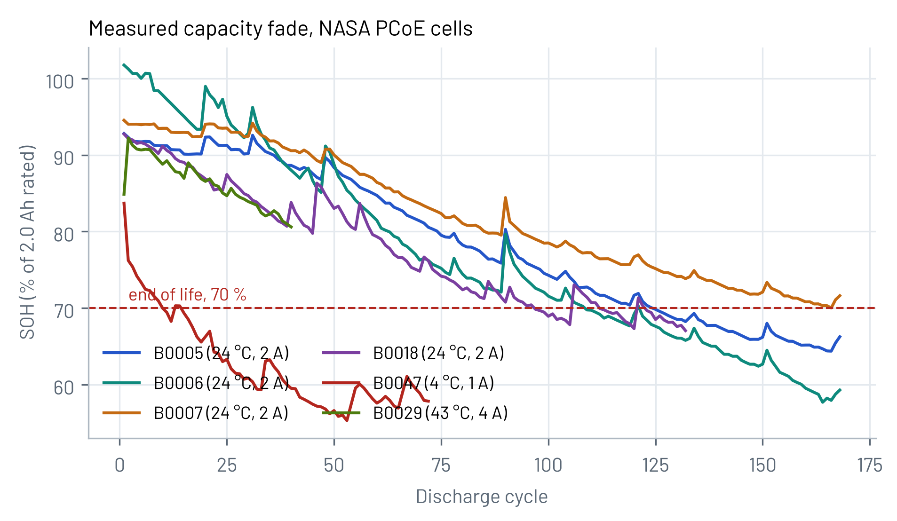
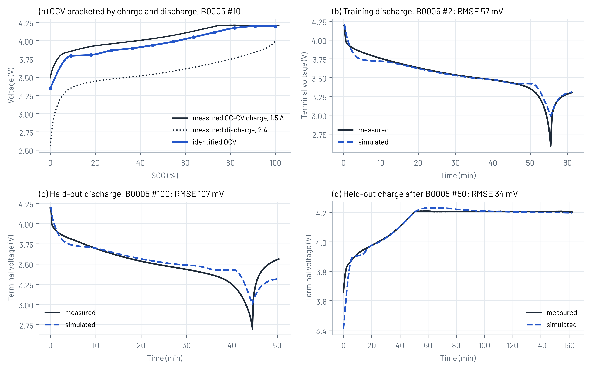
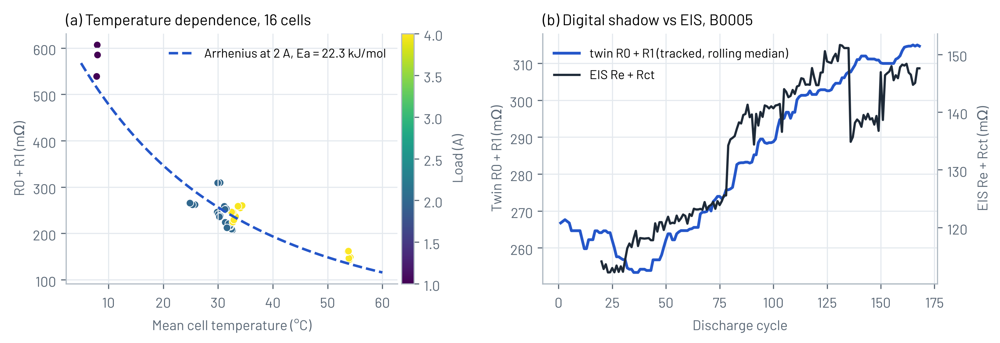
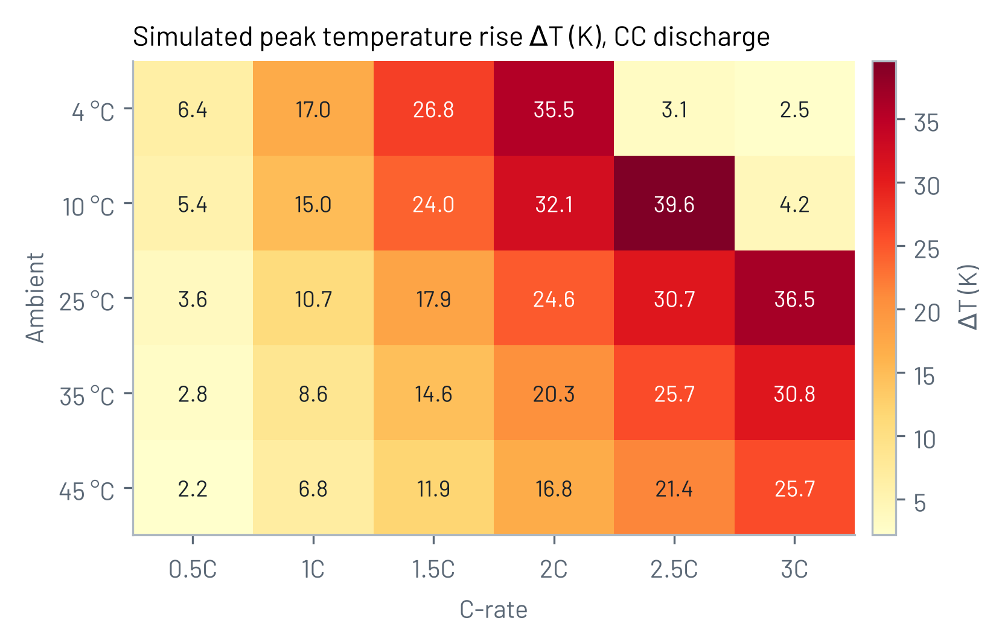
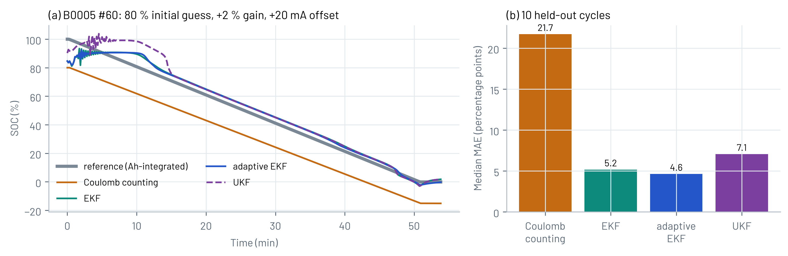
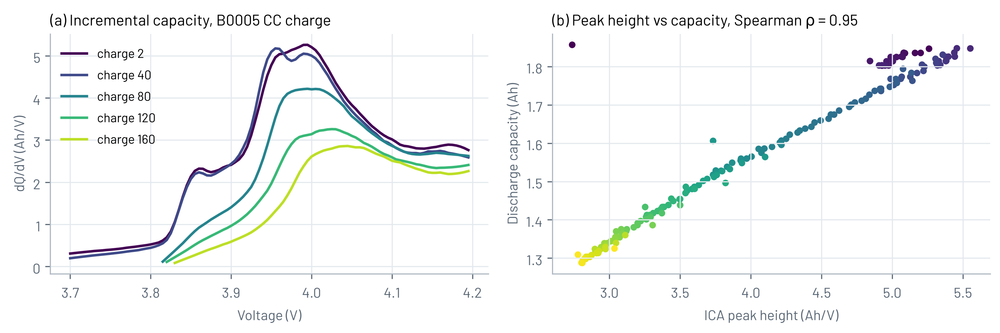
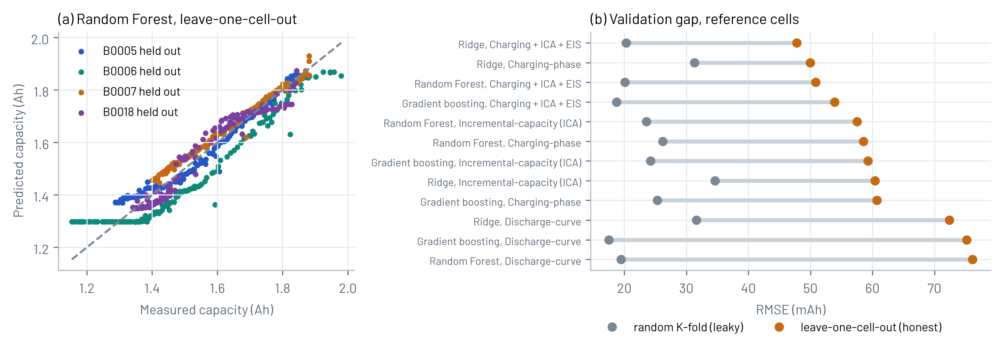
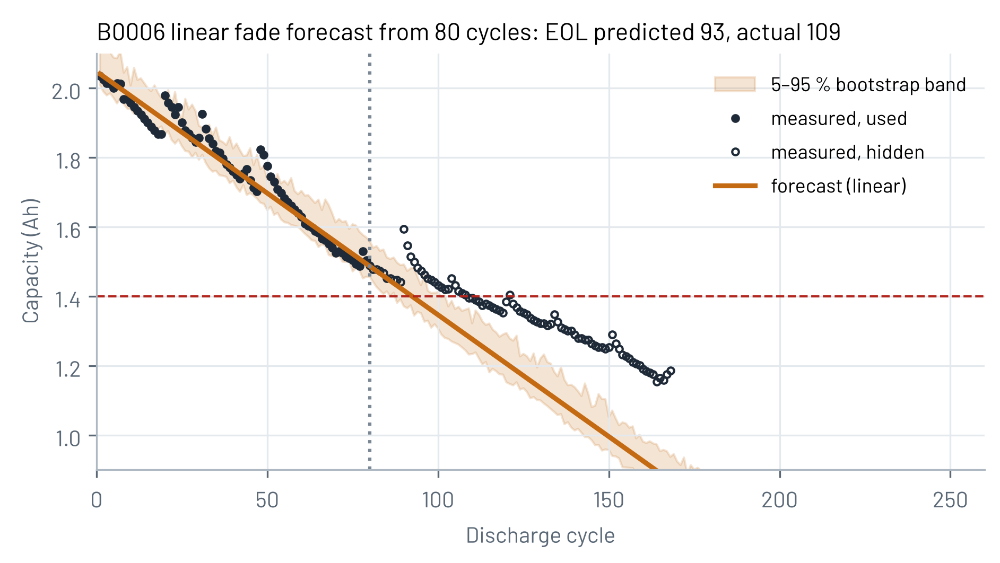
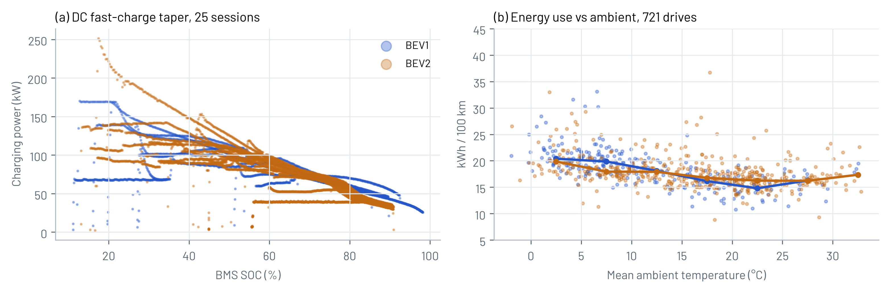

# AI-Based Virtual Laboratory for Battery Digital Twin (SOC/SOH)

**21EEO601T Electric Vehicle Technology, LLT-1. Group 14:** Bharathwaj Manoharan (RA2512053010003), Gokul Vasan R (RA2512033010022), Arvind Kumar (RA2512033010015)
SRM Institute of Science and Technology

> This report is generated from the implemented software. Every number was produced by the code in this folder
> (`bash scripts/lab.sh calibrate` regenerates them; `bash scripts/lab.sh figures` regenerates the figures). The structure follows the faculty
> template in `docs/course_brief/SubTopics.txt`.

## Abstract
SOC and SOH estimates in EV battery management degrade with ambient temperature, high C-rates and ageing. We built
an interactive virtual laboratory around a lithium-ion cell digital twin whose parameters are **identified from
measured data**, not assumed. The data are the NASA PCoE ageing tests: 34 cells, 2,767 discharges and 1,956
impedance tests at 4, 24 and 43 °C.

The twin is a first-order Thevenin model identified on both current directions, with a direction-dependent
polarisation resistance, an ohmic resistance bounded by the cell's own impedance spectrum and a temperature law
fitted across 16 cells (Ea = 22.3 kJ/mol, R² 0.89). It is coupled to a lumped thermal model. It reproduces measured
voltage within 41 mV and temperature within 1.1 K on its calibration data (five discharges and five charges). On
held-out cells under the same protocol the discharge voltage error is 81 mV; on held-out charges it is 35 mV, and the
simulated time to reach 4.2 V is within a minute of the measured one for cells above 85 % SOH. A digital-shadow
procedure re-identifies the resistances on every cycle and tracks NASA's independent impedance measurements
(Spearman ρ up to 0.88).

Under a 20-point initial SOC error and a biased current sensor, an adaptive EKF reduces the median SOC error from
21.7 % (Coulomb counting) to 4.6 %. Incremental-capacity analysis supplies physically interpretable health
indicators. With charge, ICA and impedance indicators, the Random Forest baseline estimates the capacity of an
unseen cell with 50.9 mAh RMSE (2.5 % SOH). A leaky random split would have reported 20.1 mAh. Cross-conformal
intervals cover 82 % of measurements against a nominal 90 %; Random-Forest tree intervals cover only 49 %.

Real 1 s telemetry from two Tesla Model Y packs (1,526 sessions) grounds the lab in vehicle behaviour: DC
fast-charge taper, pack heating, BMS SOC consistency, a 19 % cold-weather energy penalty, and a data-driven
identification of the LFP and NCA packs.

## 1. Introduction
**Problem.** BMS state estimates drift under temperature extremes, fast charging and ageing. The consequences are
range uncertainty, conservative operating limits and unexpected capacity loss.

**Objectives.**
- (i) Integrate real, documented battery data.
- (ii) Identify a twin from measurements and validate it on unseen cells and conditions.
- (iii) Let users vary initial SOC, C-rate, ambient temperature and ageing, and observe the electrical and thermal response.
- (iv) Compare SOC estimators under realistic sensor faults.
- (v) Estimate SOH with a Random Forest baseline under leakage-free validation, with uncertainty.
- (vi) Connect cell-level results to real EV packs.

**Scope.** A cell-level twin of the NASA 18650 cells. Vehicle telemetry is analysed, never mixed with cell parameters.

## 2. Literature review
- **Equivalent-circuit models:** Rint, Thevenin and 2-RC models trade accuracy against identifiability [5]. The 1-RC Thevenin model is the usual BMS compromise.
- **SOC estimation:** Coulomb counting accumulates sensor bias and cannot correct a wrong initial state. The EKF [3] and sigma-point (UKF) filters [4] fuse it with a voltage model. Innovation-based adaptive filters re-estimate noise statistics online [11].
- **SOH estimation:** health indicators from the charging phase and from incremental-capacity (dQ/dV) analysis track loss of lithium inventory and active material [12]. On NASA cells, recent work reports Random Forest RMSE of about 2.1 % SOH under random 5-fold CV but about 5.1 % under leave-one-battery-out, i.e. random splits are optimistic [8].
- **Uncertainty:** conformal prediction gives distribution-free intervals [13].
- **Degradation forecasting:** empirical exponential models are common for NASA RUL work [6].
- **Thermal modelling:** a lumped energy balance with irreversible and reversible (entropic) heat [7].
- **Open-source landscape (reviewed Nov 2026):**
  - NREL `thevenin` [14]: ECM plus thermal, but no fitting routine.
  - PyBaMM: physics-based models, too heavy for this scope.
  - BatteryML: no NASA loader.
  - VEHRON [15]: vehicle-level, AGPL-3.0.
  - Small Streamlit twins with unverified licences.

**Gap.** No reviewed project combines measured-data identification, multi-temperature data, digital-shadow
tracking, SOC estimators under faults, leakage-free SOH validation with calibrated uncertainty, and real EV
telemetry in one virtual lab. We therefore built a custom implementation (Appendix A).

## 3. Problem formulation and proposed methodology
**Block diagram.** See `docs/figures/system_architecture.png`: a data layer, an engine (identification, twin, estimators,
SOH) and the virtual-lab pages.

**Electrical model (I > 0 discharge).**
- V_t = OCV(z) − I·R0(T) − V1
- V1[k+1] = a·V1[k] + R1(T, sign I)·(1 − a)·I[k], with a = exp(−Δt/τ1)
- z[k+1] = z[k] − η·I[k]·Δt / (3600·Q)
- R(T) = R_ref·exp(Ea/R_g·(1/T − 1/T_ref)), T_ref = 24 °C
- R0 is shared by both current directions; the polarisation resistance takes a separate value R1,chg for
  charging current, as HPPC testing separates discharge and regen pulse resistance [16].

**Identification (two passes).**
- Data: B0005 discharges 2–6 and the CC-CV charge that follows each. A charge starts at SOC 0, the cut-off of
  the discharge before it, and is normalised by that discharge's measured capacity.
- A monotone 12-knot PCHIP OCV curve, R0, R1, R1,chg and τ1 are fitted jointly by non-linear least squares on the
  measured voltage. Rest samples are weighted 8× because they separate OCV from the resistive drop.
- R0 is bounded below by the cell's EIS ohmic resistance Re (44.8 mΩ, median of its first three EIS tests): at a
  2.5–19 s sampling interval the instantaneous resistance cannot be smaller than the high-frequency resistance.
- Pass 1 fits constant resistances. Its OCV anchors a multi-cell map: R0, R1 and τ1 are refitted on early cycles of
  26 cells with the OCV held fixed, and ln(R0+R1) is regressed on 1/T and ln I to give Ea.
- Pass 2 refits the same data temperature-aware: R0 and R1 follow the Arrhenius law along the measured cell
  temperature, which rises 10–15 K during a 2 A discharge, so the parameters refer to 24 °C.

**Thermal model.** C_th·dT/dt = I²R0 + V1²/R1 − I·T·dU/dT − hA·(T − T_amb), after the energy balance of [7]. C_th, hA and an effective
entropic coefficient dU/dT are fitted to the measured temperature of the training discharges and charges. The
reversible term changes sign with the current while I²R does not, so dU/dT is identifiable only when both
directions are in the data.

**Digital shadow.**
- R0, R1 and τ1 are re-identified on every usable discharge of B0005/6/7/18 (636 cycles), referred to 24 °C, and
  compared with EIS Re+Rct.
- R0 is bounded below by the latest EIS Re of that cell. A growth law fitted on all tracked cycles, each cell
  normalised to its own first ten, R/R_early = 1 + 0.53·(SOH_early − SOH) (R² 0.52), drives the twin's ageing state.

**SOC estimators.**
- CC: Coulomb counting.
- EKF: x = [z, V1], F = diag(1, a), H = [∂OCV/∂z, −1], P0 = diag(0.1, 0.01), Q = diag(1e-7, 1e-6)·Δt, R = 1e-3 V².
- Adaptive EKF: R_k from a 25-sample innovation window.
- UKF: same model, α = 0.3, β = 2, κ = 0.

**SOH.**
- Definition: SOH_Q = Q_meas / 2.0 Ah.
- Indicator sets:
  - charging-phase (CC/CV durations, CC charge, charge temperature rise);
  - ICA (peak height, peak voltage, charge in 3.80–4.10 V, from the charge preceding each discharge);
  - charging + ICA + EIS;
  - discharge-curve indicators.
- Models: Ridge, Random Forest (300 trees, seed 14) and histogram gradient boosting.
- Validation: leave-one-cell-out (LOCO). Random 5-fold is reported only to quantify leakage.
- Intervals: cross-conformal 90 % (half-width = 90 % quantile of the other cells' LOCO residuals) and RF tree quantiles.

**Fade forecasting.**
- Models: linear, power law, exponential and double exponential.
- Fitting: robust soft-L1 least squares with bounded parameters, a residual-bootstrap band, and AICc for comparison.
- Evaluation: a rolling-origin backtest at origins 40/60/80/100 on four cells.

## 4. Data collection and preprocessing

| Dataset | Content | Licence | Processing |
|---|---|---|---|
| NASA PCoE Battery Data Set (209.7 MB, SHA-256 recorded) | 34 cells; CC-CV 1.5 A charge; 1/2/4 A and 4 A square-wave discharges; 4, 24 and 43–44 °C; EIS 0.1 Hz–5 kHz | U.S. Gov. public | 6 inner archives extracted. B0025–28 duplicates verified byte-identical. Sign convention unified. 2,767 discharge, 2,812 charge and 1,956 EIS records; 765 k + 6.5 M samples. ICA computed for every charge |
| KU Leuven BEV energy dynamics V2 (162.3 MB, MD5 verified) | 2 Tesla Model Y vehicles, 1 s CAN: BMS SOC, pack V/I/T, ambient, speed, charger, BMS power limits | CC BY 4.0 | 25 fast-charge, 109 slow-charge and 1,392 drive sessions (3.16 M rows). 15 signals kept, GPS dropped, session summaries built, logged-time fraction recorded |

**Quality handling.**
- 232 NASA discharges have a capacity field that differs from the Ah-integration by more than 0.15 Ah.
- Low-capacity runs (< 0.5 Ah, mostly 4 °C cells, as NASA's README notes) are flagged and kept, not deleted.
- Partial charges (CC phase starting above 3.9 V) are excluded from SOH indicators.
- Tesla slow-charge sessions have logging gaps (median 62 % of time logged), so implied capacities use only sessions with more than 90 % logged.

## 5. Implementation and simulation
- **Stack:** Python 3, NumPy/SciPy (identification, simulation, filters), scikit-learn (SOH), pandas/PyArrow (parquet), Streamlit and Plotly (interface), Matplotlib (report figures).
- **Structure:** the engine lives in `src/g14lab` and is independent of the interface. The simulator integrates the coupled model at 1 s steps and re-evaluates R at the simulated temperature. Protocols are CC, CV (current solved analytically), rest, pulse and arbitrary current profile.
- **Interface:** eight pages linked by an *active twin* shown in a sidebar passport. Re-calibrating on page 2 changes every downstream experiment, and page 8 re-validates the active twin live. SOH and SOC are linked: the Random Forest capacity estimate (made with the cell held out) feeds the SOC estimators.
- **Reproducibility:** fixed seeds, saved parameter JSON, a trained model, unit tests, and an experiment log exported as a ZIP of config, CSV and interactive HTML.

## 6. Results and discussion

**6.1 Measured ageing.**

The reference cells (24 °C, 2 A) fade from 93–102 % to 58–72 % SOH over 132–168 cycles. Capacity measured at 4 °C
is lower from the start because resistance is higher, not only because of ageing. That is why SOH is defined on the
reference protocol.

**6.2 Identified twin.**

- Parameters at 24 °C: R0 = 46.4 mΩ (EIS bound 44.8 mΩ, not active), R1 = 219.5 mΩ for discharge and 27.2 mΩ for
  charge, τ1 = 108 s, OCV(100 %) = 4.20 V; fit 41.2 mV over all ten records. The constant-resistance first pass fits
  better (31.0 mV) because SOC-dependent resistance partly cancels the temperature effect within a discharge; the
  temperature-aware pass is kept because the simulator and every validation apply R(T).
- The charge–discharge asymmetry is large: the overpotential at 1.5 A charge is about 0.11 V, at 2 A discharge about
  0.53 V. A single symmetric parameter set put the OCV midway between the curves; that twin charged correctly but its
  EKF error rose from 4.7 % to 7.0 %, so the direction-dependent form was adopted.
- Thermal: C_th = 106.4 J/K and hA = 53.9 mW/K (τ_th ≈ 33 min), fit 1.08 K. The entropic coefficient, identifiable
  because both current directions are in the data, comes out negligible (−0.007 mV/K): once R1 depends on direction,
  the measured heating difference between charge and discharge needs no reversible-heat term.
- Median held-out discharge voltage RMSE:
  - 81 mV on other cells under the same protocol;
  - 96 mV across the life of B0005;
  - 190 mV at 4 A or with pulses;
  - 161 mV at 43 °C;
  - 208 mV at 4 °C.
- Median temperature RMSE 2.1 K; peak temperature at 4 A is off by −7 to +3 K.
- Held-out CC-CV charges (10 cases): replayed voltage within 35 mV and temperature within 1.2 K (medians). The
  simulated CC phase to 4.2 V is within 0.7 min (median) of the measured one for the seven charges above 85 % SOH, and
  about 11 min too long for the two aged B0005 charges and the 4 °C cell, where the OCV shape has changed.
- Limitation in CV: the twin's OCV saturates 2–3 mV below 4.2 V, so its CV current settles near 35 mA instead of
  tapering to the 20 mA cut-off. The simulator ends the CV step when the current stops decaying and reports it; a
  full CC-CV charge from SOC 0 then takes 179 min (measured about 168 min).

**6.3 Physical laws and digital shadow.**

- **Temperature law:** the fitted Arrhenius law (22.3 kJ/mol) captures the resistance rise from 54 °C down to about
  10 °C, but underestimates the 4 °C points. Cold operation is therefore flagged as extrapolation.
- **Tracking vs EIS:** the tracked twin resistance follows EIS Re+Rct (Spearman ρ 0.84 for B0005, 0.88 for B0006,
  0.75 for B0018). B0007, discharged to 2.2 V instead of 2.7 V, follows it poorly (0.31).
- **Fair one-cycle-ahead test:** every variant gets the measured capacity, so only the resistance model differs.

  | Life stage | Reference twin | Shadow (previous 5 cycles) | Growth law |
  |---|---|---|---|
  | early (> 85 % SOH) | 74.6 mV | 73.1 mV | 75.1 mV |
  | mid (75–85 %) | 99.6 mV | 101.0 mV | 96.0 mV |
  | late (< 75 %) | 142.1 mV | 127.4 mV | 124.8 mV |

  Resistance updating helps only late in life. Most of the residual error comes from the change in OCV-vs-SOC shape
  with ageing, which a fixed-OCV 1-RC model cannot represent.

**6.4 Thermal stress.**

Simulated temperature rise grows roughly with C-rate squared and with cold ambient (higher R). At high C-rate and
low temperature the cell reaches its voltage limit early, so the thermal map must be read together with the
usable-charge map in the app. Charging heats the cell far less than discharging at the same C-rate because its
polarisation resistance is about eight times smaller.

**6.5 SOC estimation.**

| Capacity given | Coulomb counting | EKF | Adaptive EKF | UKF |
|---|---|---|---|---|
| twin (fresh) | 21.70 % | 5.16 % | 4.63 % | 7.06 % |
| RF-predicted | 22.73 % | 4.98 % | 4.55 % | 6.73 % |
| measured (oracle) | 21.41 % | 5.05 % | 4.66 % | 6.74 % |

The table gives median MAE over 10 held-out cycles. The filters remove the initial error; their accuracy is
bounded by model voltage error multiplied by the OCV slope. Feeding the SOH-model capacity costs nothing compared
with an oracle.

**6.6 Incremental capacity.**

On B0005 the main dQ/dV peak falls from about 5.3 to 2.9 Ah/V and shifts to higher voltage over life. Peak height
is strongly rank-correlated with capacity.

**6.7 SOH models.**

| Indicators | Ridge | Random Forest | Gradient boosting | RF, leaky random K-fold |
|---|---|---|---|---|
| Charging phase | 50.0 | 58.6 | 60.7 | 26.2 |
| ICA | 60.4 | 57.5 | 59.3 | 23.6 |
| Charging + ICA + EIS | **47.8** | 50.9 | 53.9 | 20.1 |
| Discharge curve | 72.4 | 76.1 | 75.2 | 19.5 |

Values are LOCO RMSE in mAh on the reference cells.

- **Leakage:** random K-fold under-reports the honest error by 2–4×.
- **Extrapolation:** tree models cannot extrapolate below the training range, as the B0006 floor at 1.3 Ah shows in panel (a).
- **Across conditions (all 33 usable cells):** the linear model generalises best, at 62–77 mAh vs 69–84 mAh for the trees on the charging and ICA sets.
- **Intervals:** cross-conformal intervals cover 82 % (nominal 90 %); RF tree quantiles cover 49 %.

**6.8 Fade forecasting.**

In the backtest (16 forecasts), the linear trend has the smallest hidden-cycle error: median 101 mAh and median
end-of-life error of 8 cycles. Exponential and double-exponential models diverge (386 and 1,001 mAh; 18 and 25
cycles), even though AICc prefers them on the fitting window.

**6.9 Tesla telemetry.**

- **Fast charging:** DC power tapers with SOC, and the packs heat with peak power; median peak power is 127 kW (BEV1) and 116 kW (BEV2).
- **Capacity:** implied pack capacity is 166.8 Ah (BEV1) and 210.2 Ah (BEV2), with a standard deviation of 1.7 and 4.1 Ah over 58 sessions each.
- **Chemistry:** the mid-SOC voltage slope is 132 mV/% (BEV1) vs 972 mV/% (BEV2). Both signatures identify BEV1 as the LFP pack and BEV2 as the NCA pack (an inference, labelled as such in the app).
- **Cold weather:** drives below 10 °C use 19.5 kWh/100 km vs 16.4 at 15–25 °C (721 drives), a 19 % penalty.

## 7. Conclusion and future scope
**Achieved.**
- A measured-data-calibrated electro-thermal cell twin, identified on both current directions, with an EIS-bounded
  ohmic resistance, a fitted temperature law and digital-shadow ageing. It charges as well as it discharges.
- SOC estimators tested under realistic faults.
- An honestly validated Random Forest SOH baseline, improved by ICA indicators, with calibrated uncertainty.
- A backtested fade forecaster and real EV pack analytics.
- All of the above in one integrated virtual lab, with every number computed in-app.

**Limitations.**
- R0/R1 split weakly identifiable from coarse CC data (R0 is bounded by EIS); resistances do not vary with SOC.
- No OCV hysteresis; the charge–discharge asymmetry is carried by the direction-dependent R1.
- Effective thermal parameters identified at 2 A / 1.5 A; peak temperature at 4 A is off by −7 to +3 K.
- Four reference cells for SOH.
- BMS-reported vehicle SOC.
- An offline twin.

**Future work.**
- An ageing-dependent OCV (electrode-balancing / DVA model) to remove the late-life error.
- A 2-RC model identified from pulse data (e.g. the NASA randomized-usage set).
- Joint SOC–capacity estimation.
- A pack-level twin calibrated on the Tesla slow-charge quasi-OCV.
- A live data connection, so the twin becomes synchronised rather than offline.

## 8. References (IEEE)
[1] B. Saha and K. Goebel, "Battery Data Set," NASA Prognostics Data Repository, NASA Ames Research Center, Moffett Field, CA, 2007.
[2] M. Yasko, A. Moussa, F. Tian, H. Kazmi, J. Driesen, and W. Martinez, "Unveiling energy dynamics of battery electric vehicles using high-resolution data," *Scientific Data*, vol. 12, art. 1878, 2025; dataset doi:10.48804/8KPDTW.
[3] G. L. Plett, "Extended Kalman filtering for battery management systems of LiPB-based HEV battery packs: Part 3. State and parameter estimation," *J. Power Sources*, vol. 134, no. 2, pp. 277–292, 2004.
[4] G. L. Plett, "Sigma-point Kalman filtering for battery management systems of LiPB-based HEV battery packs: Part 2. Simultaneous state and parameter estimation," *J. Power Sources*, vol. 161, no. 2, pp. 1369–1384, 2006.
[5] H. He, R. Xiong, and J. Fan, "Evaluation of lithium-ion battery equivalent circuit models for state of charge estimation by an experimental approach," *Energies*, vol. 4, no. 4, pp. 582–598, 2011.
[6] W. He, N. Williard, M. Osterman, and M. Pecht, "Prognostics of lithium-ion batteries based on Dempster–Shafer theory and the Bayesian Monte Carlo method," *J. Power Sources*, vol. 196, no. 23, pp. 10314–10321, 2011.
[7] D. Bernardi, E. Pawlikowski, and J. Newman, "A general energy balance for battery systems," *J. Electrochem. Soc.*, vol. 132, no. 1, pp. 5–12, 1985.
[8] H. H. Le and K.-A. Nguyen, "Charging phase health indicators for battery state-of-health estimation: A systematic comparison of CC, CV, and combined approaches under cross-battery validation," *Eksploatacja i Niezawodność – Maintenance and Reliability*, vol. 28, no. 4, art. 220211, 2026, doi:10.17531/ein/220211.
[9] L. Breiman, "Random forests," *Machine Learning*, vol. 45, pp. 5–32, 2001.
[10] F. Pedregosa *et al.*, "Scikit-learn: Machine learning in Python," *JMLR*, vol. 12, pp. 2825–2830, 2011.
[11] A. H. Mohamed and K. P. Schwarz, "Adaptive Kalman filtering for INS/GPS," *Journal of Geodesy*, vol. 73, pp. 193–203, 1999.
[12] M. Dubarry, C. Truchot, and B. Y. Liaw, "Synthesize battery degradation modes via a diagnostic and prognostic model," *J. Power Sources*, vol. 219, pp. 204–216, 2012.
[13] V. Vovk, A. Gammerman, and G. Shafer, *Algorithmic Learning in a Random World*. New York: Springer, 2005.
[14] C. R. Randall, "thevenin: Equivalent circuit models in Python [SWR-24-132]," NREL, 2024, doi:10.11578/dc.20241125.2.
[15] VEHRON open-source BEV simulation framework, https://vehron.org (AGPL-3.0), reviewed 2026.
[16] *FreedomCAR Battery Test Manual for Power-Assist Hybrid Electric Vehicles*, DOE/ID-11069, Idaho National Engineering and Environmental Laboratory, Oct. 2003.

## Appendix A: Implementation decision record

| Option | Relevance | Code quality / licence | Data fit | Verdict |
|---|---|---|---|---|
| A. Adapt an existing app (small Streamlit twins on GitHub) | high | licences unverified (all rights reserved by default), unvalidated | B0005 only | rejected |
| B. Hybrid on NREL `thevenin` / PyBaMM | medium | BSD, solid | no fitting routine / heavy | reference only |
| C. Custom integrated lab (NumPy, SciPy, scikit-learn, Streamlit) | full scope | ours, tested | all 34 cells + Tesla data | **chosen** |

**Twin model decisions (each tested against held-out data before adoption).**

| Change | Evidence | Kept |
|---|---|---|
| Identify on discharges **and** the CC-CV charges after them | discharge-only twin reached 4.2 V at 16 % SOC when charging (R0 + R1 ≈ 206 mΩ applied to charge); joint twin: CC phase within 1 min of measured | yes |
| R0 ≥ EIS Re of the same cell | unconstrained joint fit drove R0 to 5–6 mΩ, below the measured ohmic resistance | yes |
| Temperature-aware second pass (R(T) along measured T) | consistent with simulation and validation, which use R(T); mean held-out RMSE 141 vs 151 mV for constant R | yes |
| Direction-dependent R1 | symmetric twin: EKF MAE 7.7 / 7.6 / 7.2 % on three test cycles; direction-dependent: 5.2 / 5.3 / 4.7 % | yes |
| Entropic heat −I·T·dU/dT | identified from both current directions; negligible once R1 is direction-dependent | kept, ≈ 0 |
| Rest dead band ±10 mA for the R1 direction | current noise at rest otherwise routed discharge relaxation through the charge resistance and over-heated pulsed cells by up to 9 K | yes |
| CV ends when its current settles | twin OCV saturates 2–3 mV below 4.2 V, so the 20 mA cut-off is unreachable | yes, reported |
| Per-cell normalised growth law | pooled law R² 0.19; per-cell normalised R² 0.52 | yes |

**Dataset decisions.**
- **NASA:** the full archive (all temperatures and loads) rather than B0005/6/7/18 only, so temperature and C-rate effects are measured.
- **Not used:**
  - Mendeley NASA-derived CSV (a single unnamed cell);
  - Bolite and TUM 2026 SOH data (existence or downloads unverifiable);
  - TUMFTM UDS data (only histograms on GitHub; raw logs are 622 MB on Zenodo).

## Appendix B: LLT compliance

| Requirement (LLT_Instruction.pdf / SubTopics.txt) | Where |
|---|---|
| Real-world EV problem with an M.Tech-level solution | Sections 1 and 3 |
| Data from reliable sources, formulas where applicable | NASA PCoE and KU Leuven RDR; Section 3 |
| Analysis, visualisation, modelling, prediction, simulation | App pages 1–8; Section 6 |
| Technical report: sections 1–8, Abstract, Appendices, contributions | this document |
| PPT and demonstration | 10-slide deck with speaker notes (PPTX and PDF in `docs/presentation`); live demonstration of the lab; figures in `outputs/figures/report`, screenshots in `outputs/figures/demo` |
| Individual contributions | table below |

## Individual student contributions

| Member | Role | Contribution |
|---|---|---|
| Bharathwaj Manoharan (RA2512053010003, M.Tech Automation & Robotics) | Project lead: system integration, digital-twin engineering and testing | System architecture and integration of data, models and the eight-page lab; electro-thermal twin (identification, Arrhenius map, thermal model, simulator, digital shadow); validation framework and test suite; report and demonstration coordination |
| Gokul Vasan R (RA2512033010022, M.Tech Networking and Communications) | State estimation and health analytics | SOC estimators (CC, EKF, adaptive EKF, UKF) under injected faults; SOH models with leave-one-cell-out validation and conformal intervals; incremental-capacity analysis and fade-forecast backtest; literature review and performance evaluation |
| Arvind Kumar (RA2512033010015, M.Tech Networking and Communications) | Data engineering: dataset and parameter selection | Selection of the NASA PCoE and KU Leuven datasets; selection of identified/fixed parameters and SOH indicator sets; data pipeline, quality flags, manifest and dictionary; Tesla session summaries |

Problem definition, design reviews, report writing and the presentation were shared by all three members.
The formatted submission report is `docs/Group14_Technical_Report.docx` (PDF copy alongside).
